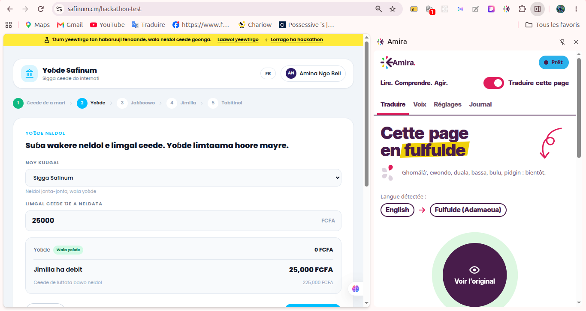

<div align="center">



# Amira

### Lire. Comprendre. Agir.

**N'importe quel service financier en ligne, dans votre langue, sans toucher à une seule ligne de son code.**

Une extension Chrome qui s'ouvre à côté de la page de la banque, la rend lisible et audible en **fulfulde**,
et ne laisse jamais une traduction modifier un montant, un frais, un bénéficiaire ou un avertissement.

*Prototype pour le SAFINUM Innovate Challenge 2026*

</div>

---

## Le problème

Au Cameroun, les applications bancaires, les plateformes de paiement et la microfinance parlent français ou anglais.
Pour des millions de personnes qui vivent en fulfulde, en ewondo ou en duala, « Frais de transfert : 1 500 FCFA »
ou « Ne communiquez jamais votre code secret » restent des phrases qu'on devine, ou qu'on fait lire par quelqu'un d'autre.
Ce quelqu'un d'autre voit alors le solde, le code, le bénéficiaire.

**Amira rend la page compréhensible là où l'utilisateur se trouve, sans intermédiaire et sans que la banque ait quoi que ce soit à changer.**

## Ce que fait Amira, en trois gestes

| | Geste | Ce qui se passe |
|---|---|---|
| 🌍 | **Traduire** | Un clic sur le gros bouton : toute la page passe en fulfulde, sur place. Les montants, numéros, dates et noms restent exactement ceux de la banque. **Voir l'original** revient à la page d'origine instantanément. |
| 🔊 | **Écouter** | Toute la page, les seuls messages importants (erreurs, avertissements de sécurité) ou les **passages que l'on choisit en les touchant sur la page**. Le passage lu est entouré en direct. Les voix enregistrées par des locuteurs natifs sont prioritaires. |
| 🛡️ | **Vérifier** | Chaque passage porte un badge : **validé** par un locuteur natif, **automatique**, ou **⚠ gardé en original** quand la traduction n'est pas assez sûre. Amira ne montre jamais une traduction douteuse. |

La langue de la page est détectée seule : français ou anglais → fulfulde, et fulfulde → français ou anglais.
Aucun réglage n'est demandé à l'utilisateur.

## Pourquoi on peut lui confier une page bancaire

> **Un montant ne passe jamais par la traduction.**

```
Sur la page            Votre solde est de 250 000 FCFA au 11/11/2026.
Masqué sur l'ordinateur Votre solde est de {N0} au {N1}.            ← seul ce texte quitte l'ordinateur
Traduit par le serveur  … {N0} … {N1} …
Vérifié sur l'ordinateur les marqueurs {N0} {N1} sont-ils tous là, une seule fois ?
                         ├─ oui → valeurs d'origine remises en place, traduction affichée
                         └─ non → le texte d'origine reste affiché, avec ⚠
```

- **Masquage local, non désactivable** : montants, devises, nombres, téléphones, e-mails, dates, références, IBAN et noms propres sont remplacés par des marqueurs **avant** tout envoi.
- **Vérification stricte au retour** : un marqueur manquant, ajouté ou dupliqué, un statut incertain ou une erreur réseau ? Le texte d'origine reste affiché. Amira préfère ne pas traduire plutôt que mal traduire.
- **Avertissements de sécurité** : ils ne sont affichés traduits que dans leur version validée par un locuteur natif.
- **Rien n'est touché** : Amira ne lit ni les cookies, ni les jetons de la page, ni ce que l'utilisateur saisit dans les champs. Elle ne clique, ne remplit et ne soumet rien.
- **Journal sans données** : il ne garde que le nom du site et des codes techniques, jamais le texte de la page.

## Réponse aux exigences de l'épreuve

| Fonctionnalité minimale attendue | Dans Amira |
|---|---|
| **1. Adaptation linguistique de l'interface** | Textes, boutons, libellés, infobulles et textes d'aide des champs. Les phrases découpées en balises (`<b>`, `<a>`…) sont traduites d'un seul tenant, sans casser la mise en page. Trois affichages : remplacer, bilingue (traduction sous l'original), original au survol. |
| **2. Prise en charge d'un parcours financier** | Le choix est mémorisé par site, la traduction suit donc l'utilisateur d'étape en étape : solde → frais → bénéficiaire → récapitulatif → confirmation. Les applications d'une seule page, les fenêtres modales, les notifications éphémères, les iframes et le shadow DOM sont pris en charge. |
| **3. Préservation des informations financières** | Masquage local + vérification des marqueurs + original gardé en cas de doute (voir ci-dessus). Les tests de bout en bout exigent **100 % de marqueurs intacts** et **0 fuite** de valeur sensible. |
| **4. Fonctionnement indépendant** | Extension Chrome Manifest V3 : aucune ligne du site n'est modifiée, aucun script n'est à intégrer côté banque. Démontré sur l'environnement officiel `safinum.cm/hackathon-test` et sur des pages qu'Amira n'a jamais vues. |
| **5. Adaptation à un contenu inédit** | Un `MutationObserver` repère tout texte qui apparaît après le chargement (message d'erreur, alerte, nouvelle étape) et ne retraduit que ce passage, sans recharger la page. Les avertissements nouvellement affichés peuvent être lus à voix haute automatiquement. |

| Critère du jury | Points | Où le voir |
|---|---|---|
| Fonctionnement du prototype | 25 | `npm run dev`, puis ouvrir Amira sur `safinum.cm/hackathon-test` |
| Intégration et indépendance | 20 | Extension seule, sans modification du site ; testée sur des pages de structures très différentes |
| Sécurité et préservation des informations | 20 | Masquage local, vérification des marqueurs, mesures dans `tests/e2e/results/metrics.json` |
| Accessibilité et expérience | 15 | Voix, gros boutons, textes agrandissables, contraste élevé, thème sombre, clavier, mouvements réduits, 320 à 480 px |
| Contenu inédit | 10 | Observation en direct des changements de la page, retraduction ciblée du passage modifié |
| Faisabilité et documentation | 10 | Contrat d'API, note de design, composants tiers déclarés, tests automatisés |

## Accessible avant d'être beau (et beau quand même)

- **On peut tout faire sans lire** : un gros bouton rond pour traduire, un autre pour écouter, des icônes et des couleurs qui ont toujours le même sens.
- **Choisir ce qu'on écoute en le touchant** : la page est déjà découpée en passages. On touche ceux qu'on veut entendre, ils s'entourent et se numérotent. Ce sont les mêmes passages que les locuteurs natifs enregistrent, donc la voix humaine est retrouvée quand elle existe.
- **Les badges de fiabilité se lisent aussi sans les couleurs** : un cercle (validé), un losange (automatique), un triangle (à vérifier).
- **Réglages d'affichage** : taille du texte, contraste élevé, thème sombre, animations réduites, panneau en français ou en anglais.
- **Clavier** : **Alt + Maj + A** traduit ou rétablit la page, **Alt + clic** bascule un seul passage, **Échap** ferme l'outil de sélection.

## Langue et validation linguistique

**Langue prise en charge : le fulfulde de l'Adamaoua**, depuis et vers le français et l'anglais.
Le ghomálá', l'ewondo, le duala, le bassa, le bulu et le pidgin sont prévus : ajouter une langue ne change pas l'architecture.

Notre règle : **aucun mot de fulfulde n'est inventé ni généré par le front.** La qualité linguistique repose sur des personnes :

1. **Statut de chaque traduction** renvoyé par le serveur : `validated` (relue par un locuteur natif), `machine` (automatique), `uncertain`.
2. **Seuil de confiance réglable** et **mode prudence** : en dessous du seuil, l'original est gardé.
3. **Boucle de correction** : depuis le panneau (onglet Journal), l'utilisateur signale une traduction et propose une correction, elle aussi masquée avant envoi. Un locuteur natif la valide, et elle devient `validated` pour tous.
4. **Voix humaines** : chaque passage a une clé stable (`segmentKey`). Un locuteur natif enregistre un passage une fois, et cet enregistrement est lu à la place de la voix de synthèse, avec l'étiquette « Voix enregistrée ».

## Architecture

```
┌──────────── Chrome ────────────────────────────────────────┐
│  Page de la banque (inchangée)        Panneau latéral Amira │
│  ┌─────────────────────────┐          ┌──────────────────┐  │
│  │ Script de contenu       │◄────────►│ React            │  │
│  │ · découpage en passages │ messages │ Traduire · Voix  │  │
│  │ · masquage local        │          │ Réglages ·Journal│  │
│  │ · vérification          │          └──────────────────┘  │
│  │ · observation en direct │                                │
│  └───────────┬─────────────┘                                │
│              │ textes MASQUÉS uniquement                    │
│  ┌───────────▼─────────────┐                                │
│  │ Service worker          │ cache · nouvelles tentatives · │
│  │                         │ journal sans données           │
│  └───────────┬─────────────┘                                │
└──────────────┼─────────────────────────────────────────────┘
               │ HTTPS : /v1/translate · /v1/tts · /v1/feedback
       ┌───────▼────────┐
       │ API Amira      │  traduction, voix, validation par des natifs
       │ (Flask)        │
       └────────────────┘
```

- **Front** : TypeScript, React 18, Vite, Manifest V3. Polices embarquées, icônes dessinées à la main, **aucune ressource distante**.
- **Back-end** : API Flask séparée. L'extension ne connaît que son adresse, fixée à la construction. Sans back-end, une simulation intégrée fait tourner tout le parcours (le texte est préfixé `⟦FF⟧`, la pastille affiche « démo »).
- **Contrat d'API complet** : [front/docs/API.md](front/docs/API.md). **Construire l'API Flask** : [backend/README.md](backend/README.md).

## Essayer en deux minutes

Prérequis : Node.js 20+ et Chrome 116+.

```bash
cd front && npm install && cd ..
npm run dev          # construit l'extension et ouvre un guide d'installation animé
```

1. `chrome://extensions` → **Mode développeur** → **Charger l'extension non empaquetée** → dossier `front/dist`.
2. Épingler Amira, ouvrir <https://safinum.cm/hackathon-test>, cliquer sur l'icône Amira.
3. Appuyer sur **Traduire**, puis passer à l'onglet **Voix** → **La sélection** et toucher un passage.

Sans rien installer : `npm run apercu` ouvre le panneau à côté d'une page bancaire fictive.

## Qualité vérifiée

```bash
npm test             # 43 tests unitaires : masquage, vérification des marqueurs, découpage en passages
npm run test:e2e     # bout en bout : HTML simple, application d'une seule page, fenêtre modale,
                     # notification éphémère, iframe + shadow DOM, changement de langue du site
npm run safinum      # lance l'extension sur l'environnement officiel du concours
```

Les tests de bout en bout mesurent la part du texte couverte et traduite, les marqueurs intacts (100 % exigé), les fuites de valeurs sensibles (0 exigé) et le temps de traitement.

## Limites connues

Nous préférons les écrire nous-mêmes :

- **Testé sur Chrome et Chromium uniquement.** Les pages internes de Chrome ne sont pas accessibles aux extensions.
- **La qualité du fulfulde dépend du back-end et des locuteurs natifs.** Tant qu'un texte n'est pas validé, il est marqué comme tel ; en cas de doute, l'original reste affiché.
- **Les navigateurs n'ont pas de voix fulfulde.** Sans enregistrement natif, la voix de synthèse est clairement étiquetée comme telle.
- **Le panneau lui-même n'est pas encore traduit en fulfulde** : `ff.json` attend un locuteur natif, car nous refusons de générer cette traduction.
- Le texte dessiné dans des images ou des `<canvas>` n'est pas traduit.

## Dépôt

```
AMIRA/
├── front/                 extension Chrome (ce qui est présenté au jury)
│   ├── src/content/       découpage, masquage, vérification, moteur, sélecteur de passages
│   ├── src/panel/         panneau latéral React
│   ├── src/background/    service worker
│   ├── src/services/      client d'API, simulation, réglages, journal
│   ├── tests/             tests unitaires et de bout en bout
│   └── docs/              API.md · DESIGN.md · COMPOSANTS-TIERS.md · captures/
├── backend/               API Flask (traduction, voix, validation) : voir backend/README.md
└── preview.png
```

**Composants tiers déclarés** : [front/docs/COMPOSANTS-TIERS.md](front/docs/COMPOSANTS-TIERS.md). Ce sont React, deux polices libres (Inter Tight, Noto Sans, qui affichent ɓ ɗ ƴ ŋ ɲ) et des outils de développement. **Aucun service externe.**

---

<div align="center">

**Amira** : parce que comprendre sa propre banque ne devrait pas demander de traducteur.

</div>
